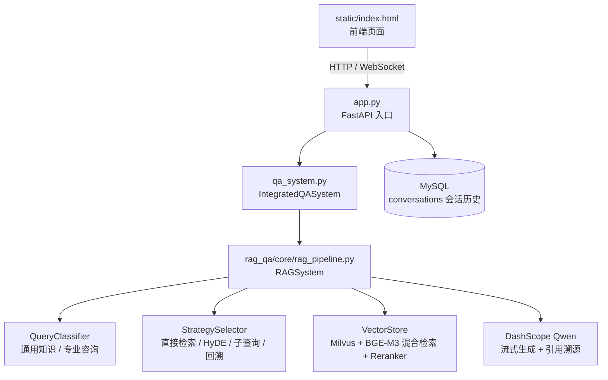

# DevDocsRAG


面向开发者的技术文档智能问答系统：Milvus 向量检索 + BGE-M3 混合检索 + 查询分类/策略选择 + 可支撑性判定，通过 DashScope Qwen 生成流式答案，并使用 MySQL 保存会话历史。

*A technical documentation RAG system with hybrid retrieval, reranking, and query routing.*

## ✨ 效果展示

<!-- TODO: 在此插入问答界面截图或提问→流式回答的 GIF，建议放 docs/images/ 下并引用相对路径 -->
<!-- 示例：

-->

## 📊 核心指标

**知识库规模**

- 覆盖 **4 类技术文档**（LangChain / Milvus / BGE·FlagEmbedding / Hugging Face Transformers）
- **740 篇文档**，Markdown/Notebook 解析 + 父子块切分后共 **32,854 条子块记录**（Milvus `devdocs_final` 集合）

**检索与答案质量**

| 指标 | 结果 |
|---|---|
| 检索评测 Recall@5（19 题） | **84.2%** |
| 检索评测 MRR@10（19 题） | **63.2%** |
| 负例误答率（11 个负例） | **36.4% → 9.1%** |
| 域外问题拒答率 | **100%** |

**服务与测试**

- 端到端真实调用 p50 约 **11s**（15 次调用统计）
- **7 套回归/验收脚本，共 202 项检查通过**

## 🏗️ 系统架构



## 🚀 快速开始

**环境要求**

- Python 3.10（建议使用独立 conda 环境）
- MySQL 8.x（数据库默认 `subjects_kg`）
- Milvus 2.5.x（默认 `localhost:19530`，集合 `devdocs_final`）
- DashScope API Key（Qwen）

**安装与配置**

```bash
pip install -r requirements.txt
cp config.example.ini config.ini   # Windows PowerShell: Copy-Item config.example.ini config.ini
```

编辑 `config.ini`，至少修改：

- `[mysql] password`
- `[llm] dashscope_api_key`
- 如 Milvus 不在本机，修改 `[milvus] host/port`

密钥也可以使用环境变量覆盖：`MYSQL_HOST` / `MYSQL_USER` / `MYSQL_PASSWORD` / `MYSQL_DATABASE`、`MILVUS_HOST` / `MILVUS_PORT` / `MILVUS_DATABASE_NAME` / `MILVUS_COLLECTION_NAME`、`DASHSCOPE_API_KEY`。

> ⚠️ 不要把真实 `config.ini`、日志或评测输出中的敏感信息提交到公开仓库。

**启动**

```bash
python app.py
```

默认监听 `0.0.0.0:8081`（可用 `HOST`、`PORT` 环境变量覆盖）。启动后访问：

- 首页：`http://127.0.0.1:8081/`
- 健康检查：`http://127.0.0.1:8081/health`
- Swagger 文档：`http://127.0.0.1:8081/docs`

## 📡 API 接口

| 方法 | 路径 | 说明 |
|---|---|---|
| GET | `/` | 前端首页 |
| GET | `/health` | 健康检查 |
| GET | `/api/sources` | 支持的技术来源 |
| POST | `/api/create_session` | 创建会话 ID |
| GET | `/api/history/{session_id}` | 获取最近 5 轮历史 |
| DELETE | `/api/history/{session_id}` | 清除会话历史 |
| POST | `/api/query` | 非流式入口；非问候问题返回转流式提示 |
| WS | `/api/stream` | 流式问答 |

WebSocket 请求示例：

```json
{"query": "Milvus 如何创建 Collection？", "source_filter": "milvus", "session_id": "..."}
```

服务端消息类型：`start -> token* -> end` / `error`。`end` 帧包含 `is_complete`、`processing_time` 和 `citations`（含 `source`、`file_path`、`repo`、`version`、`doc_type`、`url`）。

## 📁 项目结构

```
app.py                     FastAPI 入口（HTTP + WebSocket）
qa_system.py               集成问答核心：会话历史 + RAG 流式输出
config.example.ini         配置模板（占位值）
requirements.txt           Python 依赖
base/                      配置与日志
mysql_qa/                  MySQL 连接（连接/游标/关闭）
rag_qa/core/               RAG 主链路与提示词
rag_qa/models/             DevDocs 查询分类模型
rag_qa/data/               文档数据
eval/                      评测脚本、回归脚本与 results/ 结果
static/                    前端静态页面
docs/                      项目文档（概览、代码导读、架构、模块、部署、评测）
```

## 🧪 测试与回归

先启动服务（默认 8081），再运行运行期脚本：

```bash
python eval/test_phase9_cleanup.py
python eval/verify_runtime_phase8.py
python eval/verify_runtime_phase7.py
python eval/test_domain_consistency.py
python eval/test_phase6.py
python eval/test_fixes.py
python eval/test_phase51_regression.py
```

结果写入 `eval/results/`。可用 `RAG_RESULT_OUT` 指定隔离的输出路径，避免覆盖历史基线。

**检索参数**（`config.ini` 的 `[retrieval]`）：`retrieval_k = 10`、`candidate_m = 2`、`relevance_threshold = 0.2`、`support_judge = true`、`support_judge_max_chars = 4000`。

## 📖 详细文档

- [项目概览](docs/project_overview.md)
- [代码与目录导读](docs/codebase_guide.md)
- [架构与工作流](docs/architecture_and_workflow.md)
- [核心模块说明](docs/core_modules.md)
- [部署与故障排查](docs/setup_and_troubleshooting.md)
- [测试与评测](docs/testing_and_evaluation.md)

## ⚠️ 已知限制

- 无检索结果时，模型可能给出有限的通用建议，并在回答中说明"依据不足"；此时 `citations` 为 0。运行期脚本接受"拒答/说明无依据"语义，不依赖固定句式；若验收要求严格拒答（不允许任何通用建议），需收紧提示词或无答案门控后再验收。
- 本项目按技术文档领域配置，`valid_sources` 仅包含 `langchain`、`milvus`、`bge`、`transformers`。

## 🔒 交付与安全

- 交付包不得包含 `config.ini`、`config.ini*` 备份、`*.phase6bak`、`logs/`、`_backup_*/`；这些路径已加入 `.gitignore`。
- `base/config.py` 不保存真实密码兜底值；密码和 API Key 仅从 `config.ini` 或环境变量读取。
- 共享或发布前应轮换 `config.ini` 中的 MySQL 密码与 DashScope Key。

## 📄 License

[MIT](LICENSE)
